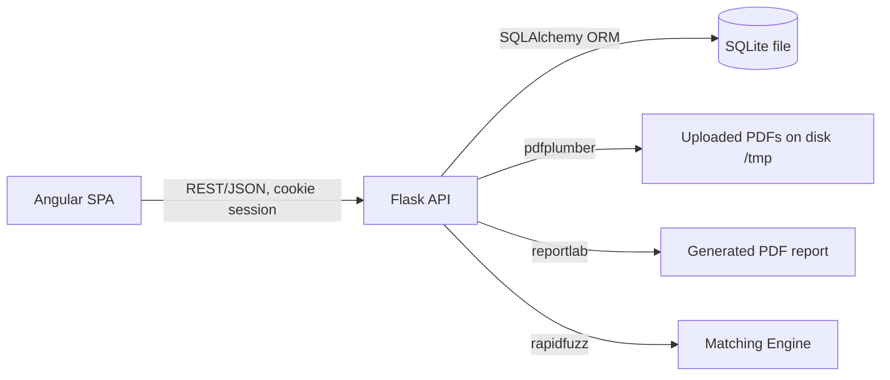

# Reconciliation App — Development Plan
**Stack:** Angular (frontend) · Python/Flask (backend) · SQLite (database)
**Source docs:** Criterion A (Problem Specification), Criterion B (Planning), Criterion C (System Overview), `expected_reconciliation_report_aug2026.pdf`, `expected_results_aug2026.csv`, sample ledger/bank PDFs.

---

## 0. Summary of Stack Change

The original Criterion A specifies **React + Bootstrap**, **PostgreSQL**, and implies role-based DB access control. This plan replaces those with **Angular** and **SQLite** per the new requirement. Consequences are called out below (Section 1) because they affect the design, not just the tooling.

| Layer | Original doc | This plan | Why it matters |
|---|---|---|---|
| Frontend | React.js + Bootstrap | Angular 17+ (standalone components) + Angular Material + SCSS | Different component/state model (services + RxJS vs hooks); rebuilt from wireframes, not ported |
| Backend | Flask | Flask (kept — still valid per original justification) | No change needed |
| DB | PostgreSQL | SQLite (file-based, via SQLAlchemy) | Loses native role-based access control & robust concurrent writes — mitigated in Section 1 |
| ORM | SQLAlchemy | SQLAlchemy (unchanged) | Works identically over SQLite |

---

## 1. Issues Found in the Existing Documentation

These are things that will silently break the app if built as literally specified. Each has a proposed fix, applied in the schema/algorithm sections below.

### 1.1 Database / ERD issues
1. **PostgreSQL-specific claims don't hold for SQLite.** The doc justifies Postgres via "role-based access control" and "handles multi-user access" via ACID transactions. SQLite has no role-based access control (RBAC) at all, and writers are serialized (one writer at a time). **Fix:** implement authorization at the Flask application layer (`flask-login` + per-user row filtering by `user_id`), enable `PRAGMA journal_mode=WAL` and `PRAGMA foreign_keys=ON` for better concurrent read/write behavior and FK enforcement (SQLite ignores FKs by default).
2. **`MATCH_RESULT.ledger_txn_id` / `bank_txn_id` are both marked required (FK, implied NOT NULL).** But the expected report has rows that are "Missing from bank" (bank_txn_id is null) or "Missing from ledger" (ledger_txn_id is null) — see CSV rows 6, 8, 9, 15, 22, 24, 25, 26, etc. **Fix:** make both FKs nullable with a `CHECK (ledger_txn_id IS NOT NULL OR bank_txn_id IS NOT NULL)` constraint.
3. **`MATCH_RESULT` has no columns to store the numeric evidence shown in the report** (`date_diff_days`, `amount_diff`, `description_similarity`). Without these, the PDF/CSV export in the expected output (Sim %, diff columns) cannot be regenerated. **Fix:** add `date_diff_days INTEGER`, `amount_diff NUMERIC`, `similarity_score NUMERIC` to `MATCH_RESULT`.
4. **Reason is a single string but real rows need multiple reasons** (CSV row 28: `"Missing from bank; Duplicate record"`). A single free-text field is acceptable for MVP but should be treated as a **semicolon-joined list**, not a fixed enum — document this contract explicitly so the backend and frontend agree on the delimiter.
5. **Money stored as `float`/`FLOAT` will introduce rounding errors** that break exact-tolerance comparisons (Appendix C requires "a difference of exactly 100 would pass"). SQLite has no native DECIMAL type. **Fix:** store amounts as **INTEGER paise/cents** (e.g., ₹25,000.00 → `2500000`) or use Python `Decimal` end-to-end with `NUMERIC` column affinity, and never compare with `==` on floats.
6. **No table/column captures the `run` concept cleanly for re-running the same files with different tolerances** (Appendix B: Run 1/2/3 on identical input). The current ERD is actually fine here (`RECONCILIATION_SESSION` holds tolerance settings per run) — just confirming each "Run" = one new session row referencing the same uploaded files. Add a `parent_upload_id` or `file_hash` column to `RECONCILIATION_SESSION` so re-running with new tolerances doesn't require re-uploading the PDFs.

### 1.2 Algorithm / flowchart issues
7. **The Transaction Matching Flowchart (Criterion C) is a naive single-pass, first-candidate-wins algorithm.** It does not satisfy the app's own test cases:
   - Appendix A, row *"12/08 Advance Meera / Advance Ganesh"*: two ledger rows and two bank rows all pass date+amount on the same day — the algorithm must pick the **best description match for each**, not the first one found. A first-match loop can cross-wire these two pairs.
   - Nothing in the flowchart says a bank row, once matched, is removed from the candidate pool (Appendix C explicitly requires one-to-one matching). Without this, one bank row could satisfy two ledger rows.
   **Fix:** replace step 3–6 of the flowchart with a **candidate-collection + greedy best-similarity assignment** algorithm (Section 3.2) — for each ledger row, collect *all* unconsumed bank rows passing date+amount, score each by description similarity, take the best, mark that bank row consumed either way (matched or partial).
8. **No explicit row-count limit check**, yet the Testing Strategy expects an error for a 10,000-row file even though Success Criteria only promises performance up to 500 rows. **Fix:** add a `MAX_ROWS = 1000` validation step (configurable) to the File Upload Validation Flowchart, returning a clear 422 error before extraction/matching runs.
9. **No explicit handling for password-protected or 0-byte PDFs** in the flowchart, but both are in the Testing Strategy table. `pdfplumber`/`pypdf` raise on encrypted files; an empty file raises on open. **Fix:** add explicit checks: `file.size == 0` → error, and wrap `pdfplumber.open()` in a `try/except` catching encryption/corruption errors, both before "Extract tables".
10. **Percentage tolerance base is ambiguous in Criterion A** ("difference up to 3%") but Appendix C clarifies "computed on the ledger amount." **Fix:** hard-code this rule in the matching service and document it in the tolerance UI tooltip so users aren't surprised when percentage is not computed against the bank amount.

### 1.3 Minor / UX issues
11. Wireframes show only 3 screens (login, upload+tolerance, results). The expected report also implies a **run history / compare-runs** view (Appendix B shows 3 runs on the same files) that isn't in the wireframes. Added as an optional "History" screen (already referenced in the nav bar mockup, just never designed).
12. Duplicate handling combines with missing-status in one reason string — the UI's simple 3-color (green/yellow/red) scheme is not quite enough to show "Matched but also Duplicate." Recommend a small icon/badge over the color instead of a 4th color, so the palette stays simple.

---

## 2. Finalized Architecture



- **Frontend:** Angular 17+, standalone components, Angular Material + a custom SCSS theme, RxJS services for API calls, `HttpInterceptor` for auth/session and error toasts.
- **Backend:** Flask + Flask-SQLAlchemy + Flask-Login (session cookies, `HttpOnly`, `SameSite=Lax`) + Flask-CORS (restricted to the Angular origin) + Flask-WTF/`itsdangerous` CSRF token for state-changing requests.
- **DB:** SQLite file under `backend/instance/reconciliation.db`, WAL mode, FK enforcement on.
- **Background processing:** reconciliation runs in a background `threading.Thread` per session with progress tracked in a small in-memory dict (or a `progress` column on `RECONCILIATION_SESSION` updated via short-lived DB writes) — no Celery/Redis needed at this scale, keeping ops simple as the original doc intended.

---

## 3. Backend Design

### 3.1 Revised Database Schema (SQLite DDL)

```sql
PRAGMA foreign_keys = ON;

CREATE TABLE user (
    id            INTEGER PRIMARY KEY AUTOINCREMENT,
    username      TEXT NOT NULL UNIQUE,
    email         TEXT NOT NULL UNIQUE,
    password_hash TEXT NOT NULL,
    created_at    TEXT NOT NULL DEFAULT (datetime('now'))
);

CREATE TABLE reconciliation_session (
    id                INTEGER PRIMARY KEY AUTOINCREMENT,
    user_id           INTEGER NOT NULL REFERENCES user(id),
    ledger_filename   TEXT NOT NULL,
    bank_filename     TEXT NOT NULL,
    file_hash         TEXT,                 -- links re-runs of the same uploaded files
    date_tolerance_days INTEGER NOT NULL DEFAULT 0,
    amount_tolerance    NUMERIC NOT NULL DEFAULT 0,
    tolerance_type      TEXT NOT NULL CHECK (tolerance_type IN ('absolute','percentage')),
    description_threshold NUMERIC NOT NULL DEFAULT 80,
    status            TEXT NOT NULL DEFAULT 'pending' CHECK (status IN ('pending','processing','done','error')),
    progress_pct      INTEGER NOT NULL DEFAULT 0,
    error_message     TEXT,
    created_at        TEXT NOT NULL DEFAULT (datetime('now'))
);

CREATE TABLE txn (
    id           INTEGER PRIMARY KEY AUTOINCREMENT,
    session_id   INTEGER NOT NULL REFERENCES reconciliation_session(id) ON DELETE CASCADE,
    source       TEXT NOT NULL CHECK (source IN ('ledger','bank')),
    txn_date     TEXT NOT NULL,              -- ISO YYYY-MM-DD
    description  TEXT NOT NULL,
    amount_paise INTEGER NOT NULL,           -- integer minor units, no floats
    row_number   INTEGER NOT NULL,
    ref_no       TEXT
);

CREATE TABLE match_result (
    id                  INTEGER PRIMARY KEY AUTOINCREMENT,
    session_id          INTEGER NOT NULL REFERENCES reconciliation_session(id) ON DELETE CASCADE,
    ledger_txn_id       INTEGER REFERENCES txn(id),
    bank_txn_id         INTEGER REFERENCES txn(id),
    match_status        TEXT NOT NULL CHECK (match_status IN ('Matched','Matched (tolerance)','Partial','Missing')),
    reason              TEXT,               -- semicolon-joined list, e.g. "Missing from bank; Duplicate record"
    tolerance_applied   INTEGER NOT NULL DEFAULT 0, -- 0/1 boolean
    is_duplicate        INTEGER NOT NULL DEFAULT 0,
    date_diff_days      INTEGER,
    amount_diff_paise    INTEGER,
    similarity_score    NUMERIC,
    CHECK (ledger_txn_id IS NOT NULL OR bank_txn_id IS NOT NULL)
);
```

Key differences from the original ERD: nullable FKs + CHECK, integer-paise amounts, added diff/similarity columns, added session status/progress columns for the progress-bar UI, added `file_hash` for re-runs.

### 3.2 Matching Algorithm (revised)

```
FUNCTION reconcile(ledger_rows, bank_rows, date_tol, amt_tol, amt_type, desc_threshold=80):
    unconsumed_bank = copy(bank_rows)   # each row usable at most once
    results = []

    FOR ledger_row IN ledger_rows (sorted by date):
        candidates = []
        FOR bank_row IN unconsumed_bank:
            date_diff = abs(days_between(ledger_row.date, bank_row.date))
            IF date_diff > date_tol: CONTINUE

            IF amt_type == 'percentage':
                allowed = ledger_row.amount * (amt_tol / 100)
            ELSE:
                allowed = amt_tol
            amount_diff = bank_row.amount - ledger_row.amount
            IF abs(amount_diff) > allowed: CONTINUE

            score = rapidfuzz.fuzz.token_set_ratio(ledger_row.description, bank_row.description)
            candidates.append((bank_row, date_diff, amount_diff, score))

        IF candidates is empty:
            results.append(Missing(ledger_row, reason="Missing from bank"))
            CONTINUE

        best = candidate with MAX(score)          # tie-break: smallest abs(amount_diff), then smallest date_diff
        remove best.bank_row from unconsumed_bank  # one-to-one: consumed whether Matched or Partial

        tolerance_applied = (best.date_diff != 0 OR best.amount_diff != 0)
        IF best.score >= desc_threshold:
            status = "Matched (tolerance)" IF tolerance_applied ELSE "Matched"
            reason = describe_tolerance(best) IF tolerance_applied ELSE "Exact match"
        ELSE:
            status = "Partial"
            reason = f"Description similarity {best.score}% < {desc_threshold}%"

        results.append(MatchResult(ledger_row, best.bank_row, status, reason,
                                    tolerance_applied, best.date_diff, best.amount_diff, best.score))

    # anything left in unconsumed_bank never matched any ledger row
    FOR bank_row IN unconsumed_bank:
        results.append(Missing(bank_row, reason="Missing from ledger"))

    # duplicate detection is independent of matching, runs on ORIGINAL rows
    FOR df IN [ledger_rows, bank_rows]:
        FOR group IN group_by(df, key=(date, description, amount)):
            IF len(group) > 1:
                FOR row IN group: append_reason(results, row, "Duplicate record")

    RETURN results
```

This satisfies every Appendix A test row, including the ambiguous same-day/same-amount pairs and the duplicate ledger entry (row 27/28).

### 3.3 File Validation Pipeline (revised)

```
1. Both files present?                       → 400 "Missing file"
2. File size > 0 bytes?                      → 400 "Empty file"
3. Extension == .pdf AND MIME sniff matches? → 400 "Not a PDF"
4. Can pdfplumber open it (not encrypted)?   → 400 "Password-protected or corrupted PDF"
5. Row count <= MAX_ROWS (1000)?             → 413 "Too many rows, max 1000 supported"
6. Table extracted with >=1 row?             → 400 "No tabular data found"
7. Columns mapped (date, description, amount found via rapidfuzz header match)? → 400 "Unrecognized column headers"
8. Dates normalized to YYYY-MM-DD (day-first vs month-first disambiguated by header format, e.g. DD/MM vs DD-Mon)
9. Amounts: strip thousands separators (Indian "1,25,000.00" and standard "1,250.00"), parse as Decimal → paise
10. Return DataFrames → proceed to matching
```

### 3.4 REST API Contract

| Method | Path | Purpose |
|---|---|---|
| POST | `/api/auth/register` | Create user (hashed password) |
| POST | `/api/auth/login` | Login, sets session cookie |
| POST | `/api/auth/logout` | Clear session |
| GET  | `/api/auth/me` | Current user info (for route guards) |
| POST | `/api/sessions` | Upload ledger+bank PDFs + tolerance settings (multipart/form-data) → creates `reconciliation_session`, starts background job |
| GET  | `/api/sessions/:id/progress` | Poll progress % + status (for the progress bar) |
| GET  | `/api/sessions/:id/results` | Paginated match results + summary counts |
| GET  | `/api/sessions/:id/export` | Stream generated PDF report (reportlab) |
| GET  | `/api/sessions` | History list for the logged-in user |
| DELETE | `/api/sessions/:id` | Remove a session and its data |

All endpoints except `/auth/*` require an authenticated session (`@login_required`) and filter by `user_id` to prevent one user reading another's data (IDOR protection).

---

## 4. Frontend Design (Angular)

### 4.1 Project structure
```
frontend/
  src/app/
    core/            # auth guard, http interceptor, api services
    features/
      auth/          # login, register
      upload/        # upload + tolerance form
      results/       # results table, summary cards, export
      history/       # past sessions list
    shared/          # reusable UI: color-coded status badge, file-drop, progress bar
    app.routes.ts
  src/styles/        # SCSS theme (Material custom palette)
```

### 4.2 Screens (upgraded from the wireframes)

1. **Login / Register** — Material `mat-card`, form validation, subtle gradient background, animated logo mark.
2. **Upload & Tolerance** — two drag-and-drop zones (`ngx` file-drop directive) with live file-type/size validation feedback, a tolerance panel with a toggle between "Absolute ₹" and "Percentage %", a date-window stepper, and a prominent "Start Reconciliation" button. A `mat-progress-bar` (determinate) polls `/progress` every second while a `mat-stepper` shows the 5 pipeline stages (Upload → Extract → Match → Flag → Report) so the user sees *what* is happening, not just a bar.
3. **Results Dashboard** — four summary stat cards (Matched/Partial/Unmatched/Total) with count-up animation, a filterable/sortable `mat-table` with virtual scroll (handles up to 1000 rows smoothly), color-coded rows (green/yellow/red) plus a small "duplicate" badge icon, a search box, per-column filters (status, source), and an "Export PDF" button with a toast confirmation on download.
4. **History** — list of past sessions (date, file names, tolerance used, summary counts) with a "re-open" action, satisfying the nav bar's "History" link that was otherwise unused.

### 4.3 Visual design direction
- Angular Material theme with a custom primary (deep teal) / accent (amber) palette — distinct from default Material purple, feels purpose-built for finance.
- Consistent 8px spacing grid, `Roboto`/`Inter` font, subtle card elevation and rounded corners (8px) for a clean fintech look.
- Empty/loading/error states designed explicitly (not an afterthought) for each screen.
- Responsive layout (desktop-first, but usable down to tablet width) since the app is used by small-business owners possibly on varied devices.

---

## 5. Testing Strategy Additions

All rows from the original Criterion C testing table are kept. Additions to close gaps found in Section 1:

| Success Criteria | Scenario | Test data | Expected Result |
|---|---|---|---|
| Performance | Abnormal | 10,000 rows/file | 413 error "Too many rows, max 1000 supported" before extraction runs |
| Automatic Matching | Normal | Two ledger rows + two bank rows, same date/amount, different descriptions (Appendix A row 12/08) | Each ledger row pairs with the bank row of highest description similarity, not first-found |
| Flagging | Normal | Duplicate ledger entry, one copy also missing from bank (row 27/28) | Both copies flagged `Duplicate record`; the unmatched copy also flagged `Missing from bank` |
| Security | Abnormal | User A requests User B's session id | 403/404 (no cross-user data leakage) |
| Tolerance | Normal | Percentage tolerance computed against ledger amount, not bank amount (Bright Minds row) | Confirms base amount used matches Appendix C assumption |

Validate the full pipeline end-to-end against `expected_results_aug2026.csv` and the three Appendix B runs — these become the **golden regression test fixtures** (unit test loads the sample PDFs, runs `reconcile()` with each of the 3 tolerance configs, and asserts the output matches the CSV row-for-row).

---

## 6. Phased Roadmap

| Phase | Scope | Depends on |
|---|---|---|
| 1. Foundation | Flask app factory, SQLite schema + migrations, Angular workspace scaffold, auth (register/login/session), route guards | — |
| 2. Upload & Extraction | Upload endpoint, file validation pipeline (incl. size/encryption/row-limit checks), pdfplumber extraction, column mapping (rapidfuzz), date/amount normalization, Angular upload UI | Phase 1 |
| 3. Matching Engine | Candidate-collection + best-match algorithm, tolerance handling, duplicate detection, unit tests against the golden CSV fixture | Phase 2 |
| 4. Reporting & Results UI | Background job + progress polling, results API (paginated), reportlab PDF export, Angular results dashboard with summary cards/table/export | Phase 3 |
| 5. History & Polish | History screen, re-run same files with new tolerances, empty/error states, responsive pass, theming polish | Phase 4 |
| 6. Testing & Hardening | Full testing-strategy table execution, security pass (CSRF, IDOR, session fixation, SQLite WAL/FK pragmas), performance check at 500/1000 rows | Phase 5 |

---

## 7. Open Decisions for the User

- Confirm **MAX_ROWS** cutoff (proposed 1000) and whether it should be configurable per deployment.
- Confirm whether **multi-currency** is ever needed (currently INR-only, hardcoded paise conversion).
- Confirm **duplicate detection key** — currently (date, description, amount) exact match; decide whether description should be fuzzy-matched too for near-duplicate detection.
